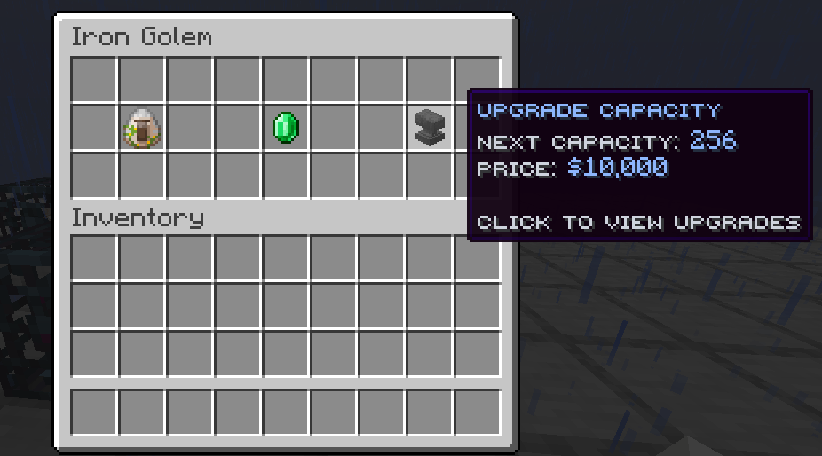

SpawnersPlus 1.5.1 stacks spawners into shared money generators on Paper 1.21.11. Requires Java 21 and Vault with an economy plugin.

| Command | Action | Permission |
| --- | --- | --- |
| `/spawners` | Show help | Everyone |
| `/spawners give <player> <mob> [amount]` | Give spawners | Admin |
| `/spawners add [amount]` | Add to the spawner you look at | Admin |
| `/spawners remove [amount]` | Remove from the spawner you look at | Admin |
| `/spawners set <amount>` | Set its count or use 0 to remove it | Admin |

Add and remove default to 1. Admin commands require `spawnersplus.admin`; spawner interactions require `spawnersplus.use`.

When updating an existing server, move its config into `plugins/SpawnersPlus/` and update permission assignments.

Build: `mvn -B -ntp verify`
